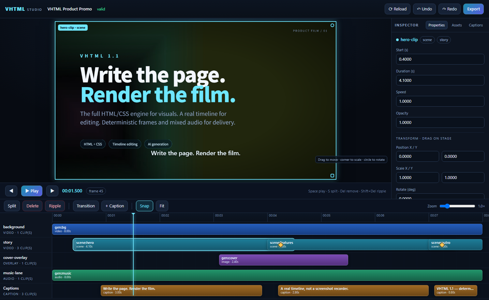
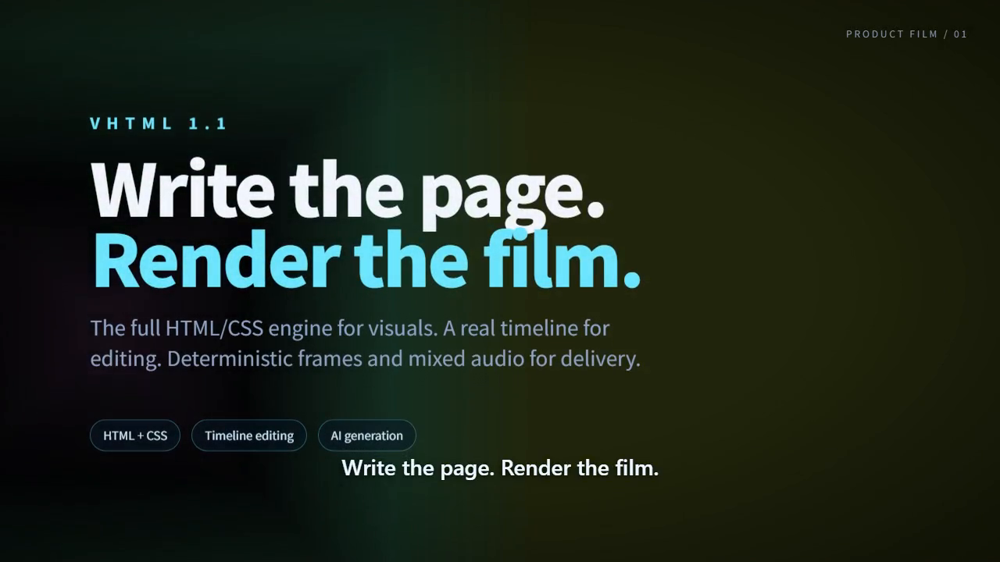

# VHTML 1.1

**Write HTML. Author, edit, generate and export video as code.**

VHTML is an HTML-compatible multimedia format and reference runtime for
deterministic video production. Standard HTML/CSS/SVG/Canvas/JS render the
visuals; VHTML adds a precise timeline, non-destructive editing, keyframes,
transitions, effects, captions, sample-accurate audio and AI generation tasks.
The same `.vhtml` project can be hand-written, generated by the TypeScript SDK,
**authored as a single-file program** (inline authoring code + JSON data blocks),
edited in the Studio, diffed in Git, and exported to MP4/WebM/GIF/WAV.

This repository is a **pnpm workspace** containing the **VHTML 1.1
specification**, independently installable npm packages, a **code-first SDK**,
a **deterministic Chromium frame sampler**, an **FFmpeg export pipeline**, a
**generation layer** and a **local/remote WYSIWYG studio**.

## Packages

| Package | Purpose |
|---|---|
| [`@sdkwork/vhtml`](packages/vhtml) | complete toolkit + `vhtml` bin |
| [`@sdkwork/vhtml-core`](packages/core) | time, model, parser, validator, serializer, storyboard, delivery presets, edits, authoring builders, program sandbox, caption parsing |
| [`@sdkwork/vhtml-sdk`](packages/sdk) | code-first authoring |
| [`@sdkwork/vhtml-runtime`](packages/runtime) | deterministic Chromium renderer/stage |
| [`@sdkwork/vhtml-media`](packages/media) | PCM mixing, captions, MP4/WebM/GIF/WAV export |
| [`@sdkwork/vhtml-project`](packages/project) | `vhtml.json`, assets, splitting, `.vhtmlpkg` |
| [`@sdkwork/vhtml-generation`](packages/generation) | AI image/video/voice/music/SFX tasks, dependency graph, providers, cache, provenance |
| [`@sdkwork/vhtml-editor`](packages/editor) | headless non-destructive editing |
| [`@sdkwork/vhtml-studio`](packages/studio) | local/remote preview + WYSIWYG server + storyboard editor |
| [`@sdkwork/vhtml-cli`](packages/cli) | CLI and embeddable `main(argv)` |
| [`@sdkwork/vhtml-schema`](packages/schema) | JSON Schemas (model, project, provider, export report) |
| [`@sdkwork/vhtml-ffmpeg`](packages/ffmpeg) | FFmpeg/ffprobe process helpers |

```bash
# complete toolkit + CLI
pnpm add @sdkwork/vhtml

# or compose only what you need
pnpm add @sdkwork/vhtml-sdk @sdkwork/vhtml-core
pnpm add @sdkwork/vhtml-runtime @sdkwork/vhtml-media
pnpm add @sdkwork/vhtml-project @sdkwork/vhtml-schema
```

All packages ship compiled **ESM + `.d.ts`**, with `exports` subpaths, source
maps and `sideEffects: false`. See [Workspace & package plan](docs/workspace.md)
for the dependency graph, release order and integration recipes.

---

## Showcase

The Studio (preview, timeline editing, save, export):



Element editing: click any authored HTML node and edit it in the Element inspector:


A frame from the generated product promo example (HTML/CSS over a procedural
background video, captions, vignette/grain):



A native 1080×1920 social teaser with safe-area captions and slide/zoom
transitions ([example](./examples/05-vertical-social)):


An offline AI-storyboard pipeline (`image` → `video` first-frame dependency,
`music`, `sfx`; see [example](./examples/06-ai-storyboard)):


All examples exported and decoded by `pnpm verify:videos` (one second each,
frame-hash motion checked):


A PPT-style 1920×1080 deck authored as HTML/CSS
([example](./examples/07-ppt-video)):


[Watch the generated 8s promo (MP4)](./docs/showcase/product-promo.mp4) ·
[WebVTT captions](./docs/showcase/product-promo.vtt) — rendered by the
reference runtime from `examples/02-product-promo/promo.vhtml`.

---

## Why VHTML

- **HTML is the rendering engine.** No new UI toolkit and no reimplementation of
  CSS. Flex/Grid, custom properties, SVG, Canvas, fonts and browser JS work.
- **A real timeline.** Scenes, lanes, clips, transitions, keyframes, audio
  mixing and captions are Core Model objects, not screenshots.
- **Exact time.** All times are rational seconds. Frame rates are ratios
  (`30000/1001`), frame boundaries are half-open, and frame counts are exact.
- **Code-first.** Loops, functions, data and generation are ordinary code; the
  SDK emits the same model as the parser.
- **Deterministic output.** Virtual clock, seeded randomness, paused/seeking CSS
  animations, media seek readiness, network policy and repeatable frames.
- **Editable project, not a binary.** A text `.vhtml` file is the source of
  truth; the Studio writes edits back to it.
- **Generation-native.** AI/procedural tasks are first-class objects with
  constraints, caching, retries and provenance.
- **Storyboard-native.** A planning layer of ordered shots links Scenes,
  generation tasks and assets; drag/drop, duplicate, reorder, inline fields and
  direction JSON are freely editable without touching Timeline timing.


---

## Requirements

| Tool | Version / notes |
|---|---|
| Node.js | **>= 22.18** |
| pnpm | **>= 10** (workspace; this repo pins pnpm 12) |
| Chrome / Chromium | current stable; detected automatically or `VHTML_CHROME_PATH` |
| FFmpeg / ffprobe | 6+ recommended; on `PATH` or `VHTML_FFMPEG` / `VHTML_FFPROBE` |

`vhtml doctor` checks Node, Chrome and FFmpeg.

```bash
# workspace development
pnpm install
pnpm build
pnpm vhtml doctor
```

The CLI is published as `@sdkwork/vhtml-cli` and is also included in the
`@sdkwork/vhtml` meta package:

```bash
pnpm add -D @sdkwork/vhtml
pnpm exec vhtml doctor
```

---

## Quick start

### Use the npm packages

```bash
# 1. scaffold a standalone project (package.json + vhtml.json + assets/ + scenes/)
npx @sdkwork/vhtml init my-video
cd my-video
pnpm install

# 2. compile TypeScript to VHTML (manifest source -> entry)
pnpm build

# 3. preview / WYSIWYG edit in the Studio
pnpm preview

# 4. export to the manifest renders/ directory
pnpm export
```

`vhtml init` creates a project-local `package.json` with
`@sdkwork/vhtml` and `build`/`validate`/`preview`/`export` scripts. You can also
install the toolkit yourself and use the CLI directly:

```bash
mkdir my-video && cd my-video
pnpm init
pnpm add -D @sdkwork/vhtml
pnpm exec vhtml init . --force
```

### Work in this workspace

```bash
pnpm install
pnpm build

pnpm vhtml init examples/my-video --force
pnpm vhtml build examples/my-video
pnpm vhtml preview examples/my-video --open
pnpm vhtml export examples/my-video
```

A `.vhtml` file is still a valid input everywhere:

```bash
pnpm vhtml validate examples/01-hello/hello.vhtml
pnpm vhtml preview examples/01-hello/hello.vhtml
```

Render a single frame:

```bash
pnpm vhtml render examples/my-video --frame 60 --out frame.png
pnpm vhtml render examples/my-video --time 2.5s --out frame-2.5s.png
```

### Project layout and external files

A project is a directory, not only a document:

```text
my-video/
  vhtml.json              entry / source / paths / preview / export settings
  video.ts                code-first source
  video.vhtml             canonical entry
  scenes/intro.html       external HTML Scene fragment
  assets/images|video|audio|fonts/
  generated/              provider outputs
  renders/                exports
  .vhtml/cache/           generated-asset cache
```

```bash
vhtml split examples/my-video --dry-run      # plan, no writes
vhtml split examples/my-video                # inline Scenes -> scenes/*.html
vhtml import examples/my-video logo.svg --to assets/images
vhtml assets import examples/my-video ./footage --to assets/video
vhtml assets list examples/my-video          # inventory + used/unused
vhtml assets verify examples/my-video        # missing / external / outside-root
vhtml assets relink examples/my-video logo assets/images/logo.svg
vhtml pack examples/my-video --out my-video.vhtmlpkg
vhtml unpack my-video.vhtmlpkg --out restored --force
```

External `<scene src="scenes/intro.html">` fragments are parsed as HTML, their
relative URLs are rebased to the project root, and their `<style>`/`<script>`
follow the normal Scene scoping rules. See
[project-layout.md](specification/project-layout.md).

File loading is sandboxed to the project root but free inside it: nested
directories, spaces, Unicode, literal `#`/`?` via `%23`/`%3F`, query/hash
suffixes, and CSS `url()`/`@import` are supported. Encoded paths are decoded
exactly once; rebased URLs are encoded once; symlinks must resolve inside the
root. Remote/`data:`/`file:` Scene URLs and root escapes are rejected.

`vhtml split` modularizes inline Scenes and rebases relative URLs; `vhtml import`
copies resources into the standard layout, probes media and deduplicates by
content hash. Large projects can therefore keep HTML, CSS, scripts and assets in
small reviewable files while the canonical entry stays readable.

One timeline can ship to several channels without re-authoring:

```bash
vhtml export ./my-video --delivery web-1080p --out renders/master.mp4
vhtml export ./my-video --delivery tiktok --out renders/tiktok.mp4
vhtml export ./my-video --delivery square-1080p --out renders/square.mp4
vhtml export ./my-video --delivery podcast-audio --out renders/podcast.wav
vhtml export ./my-video --report renders/report.json --out renders/master.mp4
```

`--report` emits a `vhtml.export-report/1` JSON with the final SHA-256, probe,
issues, generation provenance, licenses, consents and AI-disclosure flags for
commercial delivery audits.

Each delivery profile sets dimensions, fps, codecs, bitrate and a 9:16/1:1/4:5
safe area; `fit=cover|contain` prevents accidental stretching. See
[delivery-profiles.md](specification/delivery-profiles.md).

The full modular workflow is:

```bash
vhtml split ./my-video --dry-run    # inspect the plan
vhtml split ./my-video              # write scenes/*.html, rewrite entry
# for an SDK-generated project, make .vhtml canonical:
vhtml split ./my-video --detach
vhtml validate ./my-video
vhtml export ./my-video --delivery tiktok --out renders/tiktok.mp4
```

This path is covered by an integration test that splits an inline project and
exports a playable MP4 from the resulting external Scene files.

### Local and cloud deployment

The same Studio runs locally, on a LAN, or on a server:

```bash
# project launcher: scan, create and open projects
pnpm vhtml studio

# true desktop app (Electron shell over the same Studio)
cd desktop && npm install && npm start

# standalone editor window (Chrome app mode)
pnpm vhtml studio examples/my-video

# local
pnpm vhtml serve examples/my-video --open

# LAN with Basic auth
pnpm vhtml serve examples/my-video --host 0.0.0.0 --auth creator:change-me

# cloud container (Chromium + FFmpeg included)
docker compose up --build
```

Remote binds require authentication. `/__vhtml/health` is public for probes;
Studio/API/stage/static files are protected by HTTP Basic auth. Put TLS in front
(Caddy/nginx) and mount the project on persistent storage. Full guide:
[deploy.md](docs/deploy.md).

### Embedding the editor in your product

The Studio is also a component: `startStudioServer` (Node) returns a handle with
`url` / `embedUrl` / `apply(ops)` / `save()` / `project()` / `close()` for
Electron, Tauri or web hosts, and `?embed=1` exposes a postMessage bridge
(`applyOps` / `save` / `export` / `setTime` / `getState` ↔ `ready` /
`stateChanged` / `saved`). Guide with Electron/Tauri recipes:
[embedding.md](docs/embedding.md).

---

## Code-first authoring

```ts
import {
  defineVideo, clip, lane, animate, transition, caption, effect, html,
} from '@sdkwork/vhtml/sdk';

export default defineVideo({
  id: 'demo',
  width: 1280,
  height: 720,
  fps: '30/1',
  duration: '6s',
  background: '#070c16',
  scenes: [{
    id: 'hero',
    duration: '6s',
    css: `
      @keyframes rise { from { opacity:0; transform: translateY(40px) } to { opacity:1; transform:none } }
      .hero { position:absolute; inset:0; display:grid; place-items:center; color:#fff; font:800 96px system-ui }
      .hero span { animation: rise .8s ease-out both }
    `,
    html: html`<div class="hero"><span>Hello video.</span></div>`,
  }],
  lanes: [
    lane('video', 'visual', [
      clip('scene:hero', {
        id: 'hero-clip',
        start: 0,
        duration: '6s',
        animations: [animate({ property: 'opacity', from: 0, to: 1, duration: '0.6s' })],
      }),
    ]),
  ],
  captions: [caption('HTML on a real timeline.', '1s', { duration: '3s' })],
  outputs: [{ format: 'mp4', path: 'out/demo.mp4' }],
});
```

```bash
pnpm vhtml build demo.ts --out demo.vhtml
pnpm vhtml export demo.vhtml --out out/demo.mp4
```

SDK highlights:

- `defineVideo`, `scene`, `asset`, `lane`, `clip`, `caption`, `transition`,
  `effect`, `animate`, `html`, `css`
- Inline scene HTML via `clip.html` / `clip.css`
- Loops and data-driven timelines are plain JavaScript
- `applyEditOperations(project, ops)` for programmatic post-production
- Generated assets via `ref: 'gen:<task-id>'`
- Deterministic IDs and canonical serialization
- Caption alignment from data: `vhtml.parseCaptions(srtOrVtt)` turns SRT/WebVTT
  text (a data block, agent output, a file) into exact cue specs for `addCue`

### Single-file program documents

A `.vhtml` file can also *be* the program: an inline authoring script plus JSON
data blocks build the timeline when the document is loaded — loops, data and
generation with no external build step, fully deterministic.

```html
<vhtml version="1.1">
<project id="charts" version="1.1">
  <settings><composition width="1280" height="720" frame-rate="30/1" duration="6s" seed="11" /></settings>
  <timelines><timeline id="main" duration="6s"></timeline></timelines>
</project>
<script type="application/vnd.vhtml.program+javascript">
  vhtml.addLane({ id: 'visual', type: 'video', clips: [] });
  for (const row of vhtml.data.get('rows')) {
    vhtml.addScene({ id: 'row-' + row.id, html: '<h1>' + row.title + '</h1>' });
    vhtml.addClip('visual', { ref: 'scene:row-' + row.id, start: row.at, duration: 1 });
  }
</script>
<script type="application/json" id="rows">
  [{ "id": "a", "title": "Hello", "at": 0 }]
</script>
</vhtml>
```

The program runs once in a deterministic sandbox (fixed clock, seeded
`Math.random`, no I/O) and the document becomes a plain declarative project.
Data can live in external files (`<data id="rows" src="assets/data/rows.json">`)
and renders can be parameterised from the CLI —
`vhtml export video.vhtml --param accent=%236ee7ff --param cards=5` merges into
`vhtml.ctx.params` — so one document ships a whole template matrix.
`vhtml build video.vhtml` freezes the materialised model (the program is
always stripped — keep the source in version control); editors freeze
programs on save. The full authoring API,
time remaps, nested timelines and audio ducking are specified in
[video-authoring.md](./specification/video-authoring.md); see
[examples/08-code-video](./examples/08-code-video) for a complete
single-file project (data-driven scenes, generation tasks, speed ramp,
compound clip, ducked music).

---

## CLI

```text
vhtml init [dir]                 Scaffold project directory + vhtml.json
vhtml build [source|project]     Compile SDK code to canonical .vhtml;
                                 a .vhtml program document is frozen
                                 (materialised; the program is stripped)
vhtml validate [project]         Parse, validate, report diagnostics
vhtml inspect [project]          Print the resolved model
vhtml render [project]           Render one deterministic PNG frame
vhtml export [project]           Export MP4/WebM/GIF/PNG sequence/WAV/MP3
                                 --delivery web-1080p|tiktok|reels|square-1080p|cinema-4k|…
                                 --chapters mux timeline chapter markers as MP4
                                 chapter atoms (YouTube/Premiere compatible)
vhtml preview [project]          Local Studio: preview + WYSIWYG editing
vhtml serve [project]            Studio for LAN/cloud (host/auth/TLS proxy)
vhtml split [project]            Move inline Scenes into scenes/*.html
vhtml generate [project]         Materialise generation tasks
vhtml providers                  List generation providers and capabilities
vhtml edit [project]             Apply edit operations from JSON
vhtml audio [project]            Mix the soundtrack to WAV
vhtml captions [project]         Write WebVTT / SRT
vhtml assets list|verify|import|relink
                                 Manage external files
vhtml import [project] <files>   Alias for assets import
vhtml pack [project]             Create a portable .vhtmlpkg
vhtml unpack <package>           Extract a .vhtmlpkg
vhtml capabilities               Capability matrix (JSON with --json)
vhtml doctor                     Environment check
```

`[project]` may be a directory with `vhtml.json`, a `.vhtml` entry, or omitted
to use the current directory. Explicit `--out` paths resolve from the current
directory; model/output paths resolve from the project root.

Examples:

```bash
# validate a directory project with machine-readable diagnostics
vhtml validate examples/02-product-promo --json

# export a 3s cut at 60fps, with captions and loudness normalisation
vhtml export promo.vhtml --out cut.mp4 --range 2s+3s --fps 60/1 \
  --captions out/cut.vtt --loudness -14

# export all generated assets first
vhtml export promo.vhtml --out promo.mp4 --generate --force

# apply an edit script
vhtml edit promo.vhtml --ops edits.json --out promo.vhtml --backup
```

`--json` is stable and suitable for agents/CI. Exit code `0` means success,
`1` means validation/runtime failure, `2` means usage error.

---

## What is implemented

### Parsing and model

- HTML5 parsing via `parse5`; Scene HTML preserved and scoped.
- Self-closing VHTML tag recovery (`<asset />`, `<clip />`, …).
- HTML-safe core elements: `lane`, `cue`, `gen-input`, `gen-output`.
- Global ID rules, namespaced references, source locations, stable error codes.
- Full Core Model: Project, Composition, Asset, Scene, Timeline, Lane, Clip,
  Transition, Effect, Animation, GenerationTask, OutputConfig, Markers.
- JSON Schema (draft 2020-12) and a semantic validator.
- **Code authoring extension**: inline authoring programs with `<data>` blocks
  materialised in a deterministic sandbox; time remap curves; nested timeline
  (compound) clips with cycle detection; sidechain audio ducking.

### Time and editing

- Exact rational time; frame/fps/timecode parsing; rational serialization.
- Frame budget = `ceil(duration * fps)`; half-open intervals everywhere.
- Source mapping with speed, reverse, freeze, loop and **keyframed time
  remap** (speed ramps; audio uses exact curve-indexed reads).
- **A/V sync**: SMPTE frame timecodes (`HH:MM:SS:FF`, drop-frame `;FF`) with
  frame-rate context, per-clip `audio-offset` (lip-sync/latency correction)
  through parser, serializer, edits, preview and the export mixer.
- Non-destructive ops: trim, split, ripple delete, move, slip, slide, roll,
  speed, freeze, time remap, transitions, effects, animations, markers,
  **duplicate, detach audio, replace source, nest/unnest a compound clip,
  multi-lane ripple cut, splitMulti, storyboard.apply, three-point
  insert/overwrite placement, clip linking with move propagation, and a full
  clipboard (copy/cut/paste with insert & overwrite modes)** — the primitives
  agents compose into text-based editing on top of the `transcribe` task kind.
  Command-level loop: `vhtml captions --from-gen <task>` lands ASR cues as a
  caption track; `vhtml edit --ops -` accepts agent operations on stdin.
- Animation splitting at cuts; remap curve splitting; transition
  reconciliation; undo sessions.
- Nested timeline clips (compound clips) flatten recursively with cycle
  checks; nested audio mixes through the wrapper chain.

### Rendering

- Chromium stage built from the project; full HTML/CSS/SVG/Canvas.
- Deterministic profile:
  - virtual `Date`, `performance.now`, timers, `requestAnimationFrame`;
  - seeded `Math.random` / `crypto.getRandomValues`;
  - CSS/WAAPI animations paused and seeked by scene/project time;
  - video seek + `requestVideoFrameCallback`;
  - fonts/images/media readiness;
  - external network blocked by default;
  - observable frame readiness, no fixed-delay screenshots.
- Repeatable PNG hashes across frames and browser sessions in the same
  environment.
- Effects: blur/filters/vignette/grain/tint/drop-shadow/glow/rounded/masks/
  chroma-key, plus overlays.
- Transitions: crossfade, fade, dip, wipe, slide, zoom, blur.
- Captions with track/cue styling.

### Audio and export

- Per-clip FFmpeg decode (speed via `atempo`, effects), PCM mixing in Node:
  gain, pan, fades, volume automation, equal-power transitions, mute,
  sidechain **ducking**, time-remap indexed reads, nested-timeline audio.
- Master normalization, EBU R128 via `loudnorm`.
- MP4 (H.264/AAC), WebM (VP9/Opus), GIF, PNG sequence, WAV, MP3.
- Range export, frame rate override, scaling, WebVTT sidecar, JSON reports.
- Cancellation and temp cleanup.

### Generation

- First-class tasks for `image`, `storyboard`, `video`, `avatar`, `lipsync`,
  `speech`, `dub`, `music`, `sfx`, `audio`, `matte`, `edit`, `translation` and
  `text`.
- Portable `direction` schema for shot/camera/lighting, image style, first/last
  frames, reference video, voice identity/emotion, music BPM/key/structure/stems,
  SFX environment and edit strength.
- Input roles for reference images, style/character bibles, masks, first/last
  frames, reference video/audio, voice, music and scripts.
- Generation dependency graph: `gen:<task>` inputs are topologically ordered,
  cycles fail before provisioning, and selecting a downstream task brings its
  dependencies.
- `review` (pending/approved/rejected/changes-requested), `rights` (license,
  consent, likeness, voice cloning, commercial use, AI disclosure) and `safety`
  metadata.
- Deterministic `procedural` provider (SVG images, animated gradient video,
  synthesized music/audio/SFX, text); `manifest` provider; vendor-neutral
  `http` provider with sync/polling contracts. `vhtml providers` lists
  capabilities.
- Content-addressed cache keyed by task, direction, rights, inputs and provider
  version; provenance includes provider/model/seed/prompt hash/output hash.
- **Vendor coverage**: parameter mappings for 26 vendors audited against the
  portable direction model — video (Runway, Luma, Kling, Pika, Hailuo/MiniMax,
  Google Veo, OpenAI Sora, Alibaba Wan, Vidu, PixVerse, ByteDance Seedance,
  Stable Video Diffusion, Hunyuan, Adobe Firefly), image (Flux, SDXL/SD3,
  gpt-image-1, Midjourney, Ideogram, Qwen/Wanxiang), music (Suno, Stable
  Audio, MusicGen) and speech (ElevenLabs, OpenAI TTS, Azure Speech).
  Vendor-specific knobs live in `<vendor>.<param>` namespaces;
  `vhtml providers --known` prints the mapping catalog and
  `buildVendorPayload`/`vendorParams` helpers build adapter envelopes.
- Examples: `speech` + `music` + `sfx` mix into an audio lane; `avatar`/`lipsync`
  produce video; `translation` + `dub` create language variants.

### Studio

- Local-only preview page with transport, timeline, ruler, zoom.
- **Full NLE timeline**: multi-select (Shift/Ctrl+click, marquee, Ctrl+A) with
  group move/delete, clipboard with linked audio/video pairs
  (`timeline.copy`/`timeline.cut`/`timeline.paste`), place modes
  (add / insert / overwrite) for drops and pastes, right-click context menus
  for clips, lanes, the ruler and transitions, markers (`M`), In/Out points
  (`I`/`O`) feeding the export range, and a click-to-edit timecode
  (`83.5`, `1:23.5`, SMPTE `HH:MM:SS:FF`).
- **WYSIWYG stage direct manipulation**: drag/scale/rotate the selected visual
  clip with a selection box; every gesture commits `clip.set { transform }`;
  composition guides (thirds/center/safe area) and fullscreen preview.
- **Keyframe palette**: visual properties (opacity/transform) and audio
  automation (volume/pan on audible clips) added and edited at the playhead;
  keyframe diamonds on clips; the export mixer evaluates the same curves per
  sample.
- **Element-level editing**: press `E` (or **⌖ Element**), hover/click any
  authored HTML node in the player, then edit ID/class, text or inner HTML,
  attributes and inline CSS in the Element inspector. Inline Scenes use an
  undoable `scene.set`; external Scene files are patched in place and reloaded.
- Magnetic snapping to frames, playhead, markers and neighbouring clip edges;
  `Shift` bypasses snapping; vertical drag moves across lanes; `Ctrl`+wheel
  zooms at the cursor.
- Lane headers with **Mute / Solo / Hide / Lock** switches (`track.set`
  semantics: hidden lanes are excluded from preview and export; solo applies
  NLE audio solo in mixer and export); double-click renames; `＋ Lane…` adds
  video/overlay/audio/caption lanes.
- Speed section with constant presets (0.25×–4×), **speed-ramp presets**
  (Ramp in / Ramp out / Smooth S) applied as exact keyframed time remaps,
  freeze frame and detach audio.
- **Fade in/out** drag handles and fields; audio waveforms (FFmpeg peaks) and
  video poster thumbnails rendered on timeline clips.
- **Effects & transitions**: 16-type effect catalog with per-parameter editing,
  and a transition dialog (crossfade, fade, dip, wipe, slide, zoom, blur) with
  duration, direction and color.
- Asset library with upload/import, thumbnails and drag-to-timeline; missing and
  unused file reporting, plus relink for missing files.
- **Proxy preview**: one toggle switches timeline video sources to cached 360p
  H.264 copies (`/api/media/proxy`) for smooth scrubbing on 4K footage;
  exports always use the originals.
- **i18n & responsive**: English / 简体中文 UI (browser-language detection,
  one-click switch in the header), responsive layout with an inspector drawer
  for smaller windows, multi-platform safe-area overlays in guides.
- Captions tab, cue creation at playhead, text editing.
- **Storyboard tab**: add/edit/duplicate/delete/reorder shot cards by drag or
  ↑/↓, with title, duration, status, Scene/generation/asset links, tags,
  description, prompt, notes and `direction` JSON.
- **Export dialog**: delivery presets (tiktok, reels, youtube-4k, …), In/Out
  range, burn-in captions, WebVTT sidecar, EBU R128 loudness normalization and
  the `vhtml.export-report/1` audit JSON.
- Undo/redo, save back to `.vhtml`, reload external files, export with progress.
- **Round-2 polish**: ⚙ canvas settings (ratio presets/fps/background via
  `composition.set`), layer ordering, lane drag-reorder, caption-style editor,
  keyboard help (`?`), saved-revision badge, drag tooltips, rotation snapping,
  align-to-playhead, and double-click stage text for in-place element editing.
- **Round-3 polish**: `crop` now renders end-to-end (deterministic inset
  region reveal + Properties fields), a draggable volume line on audio clips,
  compound clips (nest/unnest) in the context menu, storyboard → timeline
  apply, and marker drag-retiming.
- **Round-4 polish**: playback auto-scroll, up/down clip navigation, split-all
  lanes at the playhead, draggable keyframe diamonds, lane volume/pan, a
  sidechain-ducking audio-effects panel, and animation data-integrity
  normalization at the edit boundary.
- **Round-5 polish**: interactive speed-curve (time remap) editor, single-frame
  PNG snapshots (`📷 Frame`), In/Out looped playback, Alt+drag duplicate and
  `Z` zoom-to-selection.
- **Round-6 polish**: volume envelope automation on audio clips (click to add
  points, drag to automate; mixer-exact), Alt+arrow frame nudging, ruler
  double-click markers, caption speaker field, and `animation.add` edit-boundary
  sanitization.
- All edits use the same Core Model operations as code/CLI.

### Project and external files

- Optional `vhtml.json` manifest and directory conventions (`assets/`, `scenes/`,
  `generated/`, `renders/`, `.vhtml/cache/`).
- External `<scene src>` HTML fragments with URL rebasing, CSS scoping and
  script extraction.
- Asset inventory across HTML/CSS/`@import`/scripts/generation outputs; missing,
  external, outside-root and unused classification.
- Import (hash dedupe, metadata probe), relink, verify.
- Portable `.vhtmlpkg` ZIP pack/unpack with manifests and file hashes.

---

## Repository layout

```text
packages/
  core/          @sdkwork/vhtml-core
  schema/        @sdkwork/vhtml-schema + schemas/vhtml-1.1
  ffmpeg/        @sdkwork/vhtml-ffmpeg
  runtime/       @sdkwork/vhtml-runtime (stage, renderer, browser entry)
  media/         @sdkwork/vhtml-media (audio, captions, export)
  project/       @sdkwork/vhtml-project (manifest, assets, packaging)
  generation/    @sdkwork/vhtml-generation
  sdk/           @sdkwork/vhtml-sdk
  editor/        @sdkwork/vhtml-editor
  studio/        @sdkwork/vhtml-studio
  cli/           @sdkwork/vhtml-cli
  vhtml/         @sdkwork/vhtml meta package
specification/   normative spec, profiles, RFCs
conformance/     manifest-driven fixtures
examples/        01-hello, 02-product-promo, 03-data-driven,
                 04-programmatic-edit, 05-vertical-social, 06-ai-storyboard,
                 07-ppt-video, 08-code-video
tests/           unit + integration (Chromium/FFmpeg)
pnpm-workspace.yaml
tsconfig.base.json
```

Packages are compiled into `packages/<name>/dist` and published independently.
`pnpm-workspace.yaml` includes `packages/*` and `examples/*`; the examples depend
on the workspace meta package and have their own `build`/`validate`/`preview`
scripts.

---

## Specification

Start at [`specification/README.md`](./specification/README.md):

- [Core specification](./specification/VHTML-1.1-Specification.md)
- [Editing model](./specification/editing.md)
- [Rendering & determinism](./specification/rendering.md)
- [Project layout & external files](./specification/project-layout.md)
- [WYSIWYG editing](./specification/wysiwyg.md)
- [JSON Schemas](./packages/schema/schemas/vhtml-1.1/)
- [Video authoring extension](./specification/video-authoring.md) — programs, time remap, nested timelines, ducking
- [Generation protocol](./specification/generation.md)
- [Storyboard profile](./specification/storyboard.md)
- [Commercial delivery profile](./specification/commercial.md)
- [Industry alignment](./specification/industry-alignment.md)
- [Conformance](./specification/conformance.md)
- [RFCs](./specification/rfc/)
- [Architecture notes](./docs/architecture.md)
- [SDK reference](./docs/sdk.md)
- [Studio guide](./docs/studio.md)
- [Standard audit & roadmap](./docs/standard-audit.md)
- [Versioning policy](./specification/versioning.md)

Key 1.1 decisions:

1. `<track>` → `<lane>`, `<caption>` → `<cue>` (HTML-safe containers).
2. Transitions require clip overlap; no implicit source handles.
3. Generation results are `gen:<task-id>` assets with a cache and provenance.
4. Deterministic frames are a protocol, not a delay.
5. Editing operations are part of the Core Model.
6. Authoring programs are a build-time concept: the document runs its program
   once, deterministically, and becomes a plain declarative project.

---

## Tests and verification

```bash
pnpm typecheck
pnpm test
pnpm examples
pnpm verify:videos
node scripts/check-packages.mjs
```

- **Build**: every package compiles to `dist` ESM + declarations; export targets
  and bundled runtime/schema assets are checked.
- **Unit**: exact time, parser/serializer round-trip, validator, animation,
  edit operations, JSON Schema, conformance fixtures, project manifests,
  external Scene rebasing, asset inventory/import, delivery profiles,
  generation direction/rights/dependency/provider schemas, storyboard
  parse/serialize/edit/validation, percent-encoded external files and
  `.vhtmlpkg` round-trip, authoring-program materialisation/determinism/
  sandbox, time remap evaluation, nested timeline flattening and cycles.
- **Integration**: deterministic Chromium sampling (repeat hash equality),
  MP4 + AAC + WebVTT export probed with ffprobe, and **inline project → split
  external Scene files → MP4 export**, including durable `--detach` source
  projects, end-to-end; Studio storyboard add/edit/reorder API is exercised
  against a real server.
- **Packaging**: package exports are imported from all subpaths; packed tarballs
  are installed in a clean consumer and type-checked with TypeScript.
- **Studio (manual/API)**: WYSIWYG move/scale/rotate commit, element-level
  selection/editing (text, attributes, inline CSS, external Scene write-back),
  asset upload and drop, captions and transitions are exercised against the
  local Studio; see [studio.md](./docs/studio.md).
- **Examples**: `pnpm examples` compiles every TS example; `pnpm verify:videos`
  exports one second of every example and verifies stream, frame count and
  non-frozen frame hashes with ffprobe/ffmpeg.

Known environment-dependence: Chrome version, fonts, OS, color profile and
rasterizer. The reference runtime records its environment and only promises
pixel equality inside a pinned environment; temporal determinism is stronger.

---

## Status

VHTML 1.1 is a **candidate specification** with a working reference runtime.
The implementation is intentionally dependency-light (Chromium via
`puppeteer-core`, HTML parsing via `parse5`, bundling via `esbuild`, media via
FFmpeg). It is suitable for automation, template/batch production, agent
workflows and as a foundation for a product editor.

Not yet attempted in 1.1: distributed rendering, full GPU compositing,
multi-user collaboration, a hosted service, or vendor-specific model SDKs.

## License

MIT
