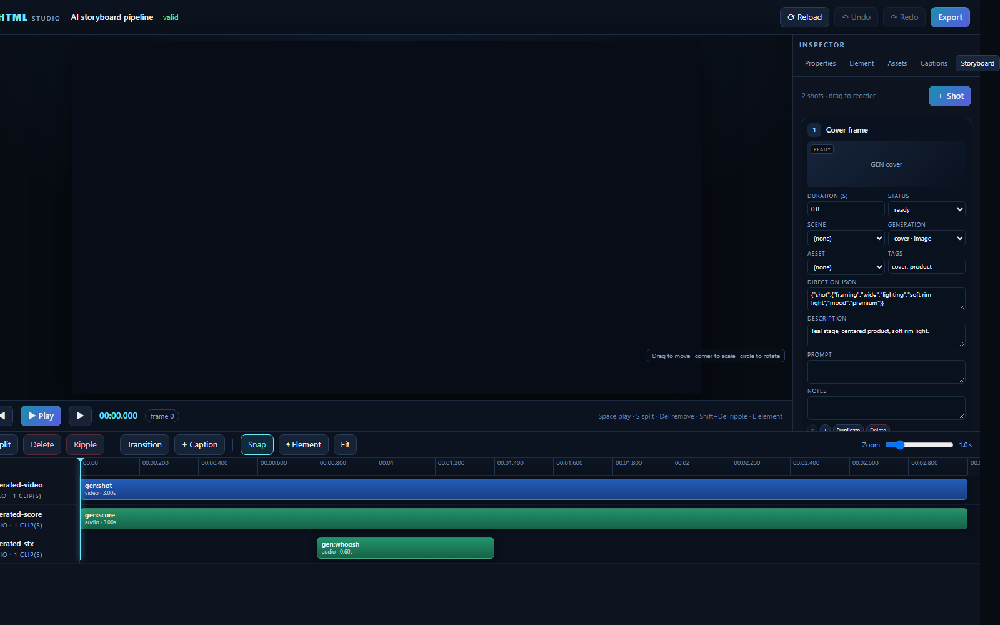
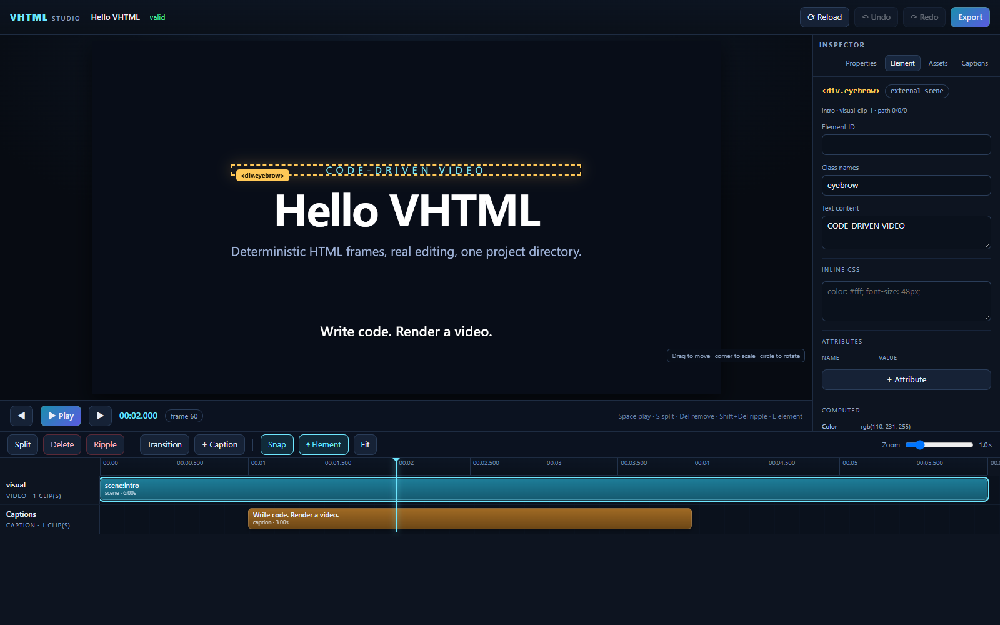
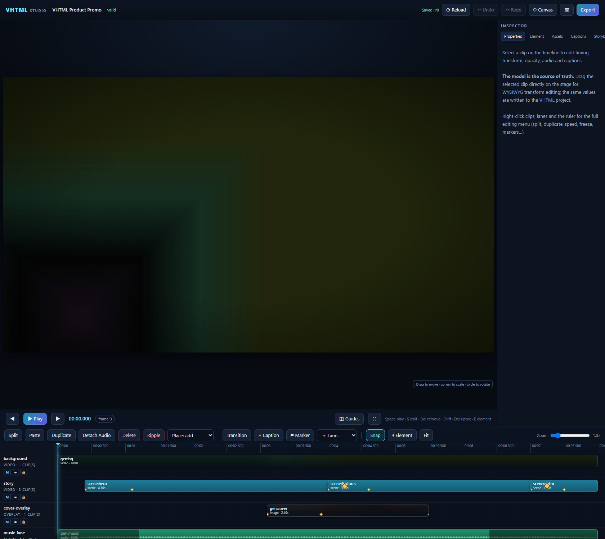
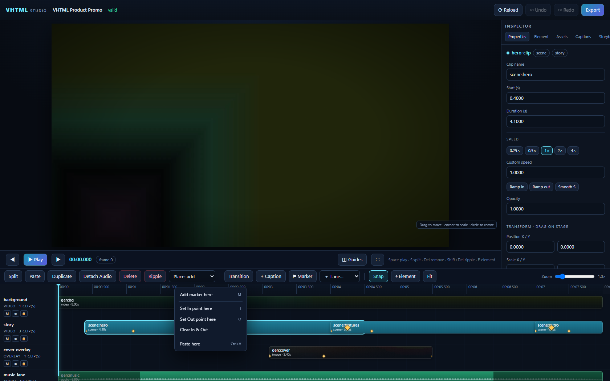

# Studio (Preview + WYSIWYG Editing)

Published as **`@sdkwork/vhtml-studio`**; also available as
`@sdkwork/vhtml/studio` and the `vhtml preview` CLI command.

```bash
# CLI (included in the meta package)
pnpm add -D @sdkwork/vhtml
pnpm exec vhtml preview ./my-film --open

# Embedded server
pnpm add @sdkwork/vhtml-studio
```

```ts
import { startStudio } from '@sdkwork/vhtml-studio';
await startStudio('./my-film', { port: 4173, open: true });
```

A project directory with `vhtml.json`, a `.vhtml` entry, or a `vhtml.json` file
is accepted.

The Studio binds to `127.0.0.1` only and serves the project root. Every edit is
applied to the Core Model, validated, saved atomically to the entry `.vhtml`,
and the stage is rebuilt. Invalid edits return `422` and do not persist.

## Storyboard

The **Storyboard** tab is a free-editing planning surface:

- **＋ Shot** adds a shot; **Duplicate** creates a copy after the current card;
- inline fields edit title, planned duration, status, tags, description, prompt,
  notes and `direction` JSON (camera, framing, lighting, sound, music);
- Scene / generation / asset selects link planning to real project objects;
- drag cards, or use ↑/↓, to reorder;
- **Delete** removes the shot and renumbers the rest;
- **⤓ Apply to timeline** materialises every shot in order onto the timeline
  (`storyboard.apply`, append + 0.25s gap, collision-checked);
- every change is a `storyboard.*` Core edit, validated and undoable; a failed
  edit is rolled back and never written to disk.

The timeline remains authoritative for playback. Storyboard edits never move
clips or change composition duration implicitly.



## WYSIWYG direct manipulation

Select a visual clip on the timeline or on the stage. A selection box appears
around the live layer:

- drag the box to move the clip;
- drag the bottom-right corner to scale X/Y;
- drag the circular handle (inside the top-right corner) to rotate;
- values are written as `clip.set { transform }` in composition pixels and
  immediately reflected in the Inspector.

The stage is scaled to the window; pointer deltas are converted with the current
`iframeRect.width / composition.width` scale. Playback hides the selection box.
The model is the only source of truth — DOM transforms are feedback until the
pointer is released.

## Element editing

Every authored HTML node inside a Scene is editable, not just the clip layer:

1. Click **⌖ Element** in the timeline toolbar (or press `E`).
2. Hover the player to see the element outline, then click a node.
3. The Inspector switches to **Element**. Edit:
   - ID and class names;
   - text for leaf nodes, or **Inner HTML** for containers;
   - any attribute (add/remove/rename), e.g. `src`, `href`, `alt`, `title`,
     `aria-label`, `data-*`;
   - inline CSS declarations;
   - read-only computed color/background/font/display/opacity for context.
4. **Apply changes** writes one validated, atomic update and refreshes the stage.



The element path is the index chain among content elements, ignoring the
`<style>`/`<script>` nodes extracted by the VHTML parser. The same path is used
for inline Scene HTML and external Scene files.

- Inline Scenes apply a `scene.set { html }` edit, so **Undo/Redo** works.
- External Scenes (`<scene src="scenes/intro.html">`) patch the external file
  directly with `parse5` source serialization, then reload the project. The file
  is the source of truth; external element edits are not added to the undo stack.
- Images, links and other scene media use the same attribute editor;
  `` dimensions can be changed with inline CSS (`width`, `height`,
  `border-radius`, `filter`, …).
- The generated `.vhtml-scene-root` wrapper and synthetic clip/caption/media
  layers are not authored HTML and are intentionally not selectable.

Element edits use the same parser/validator/serializer pipeline as the CLI. A
patch that would produce an invalid project is rejected and the Scene HTML is
left unchanged.

## Timeline



The timeline is a full non-linear editing surface; every gesture is one
validated Core Model edit (undoable, saved atomically).

- Move, trim, split, ripple delete; drag vertically to another compatible lane.
- **Multi-select**: `Shift`/`Ctrl`+click adds clips; dragging on empty lane area
  draws a marquee rectangle; `Ctrl+A` selects all clips. Group drags move the
  whole selection; Delete removes every selected clip.
- **Clipboard**: `Ctrl+C`/`Ctrl+X`/`Ctrl+V` and the Paste/Duplicate buttons use
  the normative `timeline.copy`/`timeline.cut`/`timeline.paste` operations. The
  **Place** selector chooses `add` (overlay), `insert` (push following clips
  right) or `overwrite` (replace the covered range) for drops and pastes.
  Linked clips ride together: a detached-audio pair keeps video+audio united.
- **Context menu** (right-click a clip, lane header, ruler or transition):
  split, duplicate, copy/cut/paste, speed presets (0.25×–4×), speed ramps
  (slow–fast–slow / fast–slow–fast / clear), freeze frame, detach audio,
  enable/disable, mute, ripple delete, delete; lane menus rename, mute, hide,
  lock, add or delete lanes; ruler menus drop/rename/delete markers and set
  In/Out points.


- **Markers** (`M`) appear as flags on the ruler; In (`I`) / Out (`O`) points
  highlight the working range and feed the export dialog.
- Video clips show a poster frame from `/api/media/poster`; audio-capable clips
  draw a real waveform from `/api/media/peaks` (FFmpeg-decoded, cached under
  `.vhtml/cache/studio-media/`).
- **Fade handles**: drag the clip edges (or edit the fields) to set
  `fadeIn`/`fadeOut`; shaded triangles preview the ramp.
- **Volume line & envelope** (audio clips): the draggable white line maps to
  `clip.set volume` (0-200%) with a live percentage readout — the CapCut-style
  gain gesture. **Double-click the line to drop volume keyframe points**, drag
  the green dots to automate level and timing (piecewise-linear envelope
  rendered over the waveform, evaluated per-sample by the export mixer), and
  double-click a point to remove it. During playback the timeline
  **auto-scrolls** (page-flip) to keep the playhead in view.
- **Keyframe diamonds drag**: drag a diamond horizontally to retime that
  keyframe (`clip.set animations`, clamped to the clip and sorted on commit).
- **Audio effects**: the Properties panel lists a clip's `audio-effect`s and
  adds sidechain **ducking** (sidechain lane, threshold, reduction, attack,
  release, hold) via `effect.add { audio: true }`; the export mixer evaluates
  the same envelope.
- **Speed curve editor**: clips with a time remap get an interactive SVG
  curve (X = clip time, Y = source position) with draggable points, per-segment
  average speed labels, click-to-add (monotonicity-clamped, linearly
  interpolated) and double-click-to-remove — all committed as `clip.timeremap`.
- **📷 Frame** (transport) renders the current frame to `renders/*.png` via the
  `/api/snapshot` job endpoint. With In/Out set, playback **loops the range**.
  `Alt`+drag duplicates the selection at the drop position; `Z` zooms the
  timeline to the selection.
- **Compound clips**: right-click creates a nested-timeline clip from the
  selection (`timeline.nest`) and flattens one again (`timeline.unnest`).
- **Crop**: the Properties panel crops a clip by frame percentage
  (`clip.set crop`); the stage and exports honour it as an inset region
  reveal.
- **Split all lanes at playhead** from the ruler context menu; `↑`/`↓` select
  the previous/next clip chronologically.
- **Keyframe diamonds** mark animation keyframes on the clip; edit them in the
  Properties panel.
- Magnetic snapping to frames, playhead, markers, 0/end and every other clip
  edge; hold `Shift` to bypass. `Ctrl`+wheel zooms around the cursor.
- Transitions open a dialog with type (crossfade, fade, dip, wipe, slide, zoom,
  blur), duration, direction and dip color.
- **Lane drag reorder**: drag a lane header vertically past a neighbour's
  midpoint to restack lanes; orders are written as `track.set` batch.
- Lane headers carry mute / solo / hide / lock switches; the lane context menu
  also sets **lane volume/pan** (consumed by the export mixer) — all through
  `track.set` semantics:
  hidden lanes are excluded from preview **and** export; solo silences other
  audio lanes in preview and export; muted lanes silence audio),
  double-click renames, `＋ Lane…` adds video/overlay/audio/caption lanes.

## Properties panel

Select a clip to edit everything the model supports:

- name, start, duration, speed (presets + custom + speed-ramp state), z, fit,
  blend, opacity, transform (also draggable on stage, with **rotation snapping**
  to level/diagonal angles and live x/y/scale/rotate readouts while dragging);
- **Layer ordering**: bring forward / send backward / front / back from the
  clip context menu; multi-selection can be aligned to the playhead;
- audio: volume, pan, fades, mute, detach-audio;
- captions: text;
- **Keyframes**: add per-property keyframe tracks (opacity, position, scale,
  rotation) at the playhead, then edit each keyframe's time, value and easing;
- **Effects**: 16 effect types (blur, brightness, contrast, saturate,
  grayscale, sepia, invert, hue-rotate, drop-shadow, glow, grain, vignette,
  tint, rounded, mask, filter) with per-parameter editing, enable/disable and
  remove.

## Assets

The **Assets** tab inventories declared and generated assets, missing references
and unused files.

- **Import** copies images/video/audio/fonts into the project layout
  (`assets/images`, `assets/video`, `assets/audio`, `assets/fonts`), probes
  metadata, hashes and registers them as `<asset>`.
- Drag an asset onto a compatible lane, or press `+` to add at the playhead.
  Images/SVG default to 3s; video/audio use their probed duration.
- Missing assets are outlined; the `↺` button relinks them to a file inside the
  project root and validates before saving.
- Audio lanes accept audio assets or the audio of a video asset; caption/data
  lanes reject media.
- Thumbnails come from the project static server; no external upload service.

## Captions

**Captions** tab lists cues in time order. “Cue at playhead” creates a 2s cue;
click a cue to edit its text, optional **speaker** and timing in Properties. The **Caption style** editor
writes the caption lane's `captionStyle` CSS (font size, text color, background,
bottom offset) so every cue on that lane shares one look; per-cue `style`
overrides still win. Cues export as WebVTT/SRT and can be burned in.

## External files

- **Reload** re-reads the entry, re-parses external `<scene src>` files, rehydrates
  generated assets and rebuilds the stage. Use it after editing `scenes/*.html`,
  CSS or asset files on disk.
- Missing files are reported at startup; Studio still opens in repair mode so
  the project can be fixed/relinked.
- The manifest `paths` are obeyed for imports, generated output, renders and
  cache.

## Canvas & project settings

**⚙ Canvas** (header) opens the project settings: aspect-ratio presets
(16:9, 9:16, 1:1, 4:5, 2.35:1, 4K), explicit width/height, frame rate
(24/25/30/50/60) and background color. Everything applies as one
`composition.set` edit — clips and authored HTML keep their layout.

## Help

The **⌨** button (or `?`) lists every keyboard shortcut in a dialog. The header
shows a persistent **Saved · r<revision>** badge after every applied edit.

## Export

The export dialog offers:

- **Delivery presets** (`web-1080p`, `tiktok`, `reels`, `shorts`,
  `youtube-4k`, `square-1080p`, `cinema-4k`, `podcast-audio`, …) that set
  format, size, frame rate and fit; or fully custom settings;
- range start/duration with a **Use In/Out** shortcut for the timeline range;
- **Burn captions** into the picture, a **WebVTT sidecar**, and an
  **audit report** (`vhtml.export-report/1`);
- optional **loudness normalization** (EBU R128 `loudnorm`, e.g. `-14` LUFS).

Completed jobs link the video, captions sidecar and report.

## API

| Route | Method | Purpose |
|---|---|---|
| `/studio` | GET | Studio page |
| `/api/project` | GET | normalized studio model + diagnostics + root/layout |
| `/api/assets` | GET | asset library, summary, missing references |
| `/api/inventory` | GET | full asset inventory with origins |
| `/api/assets/upload` | POST | raw file body + `x-filename` header |
| `/api/assets/relink` | POST | `{ assetId, src }` (inside project root) |
| `/api/clip-from-asset` | POST | `{ assetId, trackId, start, duration?, mode? }` (`add`/`insert`/`overwrite`) |
| `/api/caption` | POST | `{ text, start, duration? }` |
| `/api/element` | POST | `{ sceneId, path, patch: { attributes?, style?, text?, innerHTML? } }` |
| `/api/edit` | POST | `{ operations: EditOperation[] }` (includes `timeline.copy/cut/paste`, `marker.*`, `track.*`, `animation.*`) |
| `/api/undo` | POST | undo |
| `/api/redo` | POST | redo |
| `/api/reload` | POST | re-read external files and reset the edit session |
| `/api/presets` | GET | delivery preset catalog for the export dialog |
| `/api/media/peaks` | GET | `?asset=<id>` normalized audio waveform buckets (cached) |
| `/api/media/poster` | GET | `?asset=<id>&t=<sec>` JPEG frame thumbnail (cached) |
| `/api/clipboard` | POST | `{ action: copy\|paste\|clear, clipIds?, start? }` REST clipboard shim |
| `/api/snapshot` | POST | `{ time }` renders one frame to `renders/*.png` (job) |
| `/api/export` | POST | start export job (`delivery`, `burnCaptions`, `captions`, `loudness`, `report` supported) |
| `/api/job/:id` | GET | export progress/result |
| `/__vhtml/stage.html` | GET | live stage document |

## Keyboard

| Key | Action |
|---|---|
| Space | play/pause |
| ← / → | previous/next frame |
| Shift+← / Shift+→, PgUp / PgDn, J / L | ±1 second |
| K | pause |
| Home / End | jump to start/end |
| S | split selected clip(s) at playhead |
| T | open the transition dialog |
| C | add caption at playhead |
| M | drop a marker at the playhead |
| I / O | set In / Out point |
| D / Ctrl+D | duplicate selected clip(s) |
| Ctrl+C / Ctrl+X / Ctrl+V | copy / cut / paste (Place mode honored) |
| Ctrl+A | select all clips |
| G | toggle composition guides (thirds, center, safe area) |
| F | fullscreen preview |
| + / − / 0 | zoom in / out / fit (Ctrl+wheel zooms at the cursor) |
| Delete / Backspace | remove selected clip(s) |
| Shift+Delete | ripple delete |
| Ctrl+Z | undo |
| Ctrl+Shift+Z / Ctrl+Y | redo |
| Shift (drag) | disable snapping |
| E | element picker |
| ↑ / ↓ | select previous / next clip (chronological) |
| Z | zoom the timeline to the selection |
| Alt (drag) | duplicate the dragged clips at the drop position |
| Alt+← / → | nudge selected clips by one frame |
| double-click (ruler) | drop a marker at that time |
| ? | keyboard shortcut help |
| Esc | close menu/dialog, drop selection |

Click the timecode to type an exact time (`83.5`, `1:23.5`,
`00:01:23:15` SMPTE with the project frame rate). Double-click any text on the
stage to jump straight into the Element editor for that node (CapCut-style
in-place text editing); the postMessage bridge (`?embed=1`) accepts
`vhtml:command` commands (`applyOps`, `setTime`, `play`, `pause`, `save`,
`export`, `getState`) from a host shell.

The full normative editor contract is [specification/wysiwyg.md](../specification/wysiwyg.md).
For LAN/cloud Studio with auth and TLS, see [deploy.md](./deploy.md).
