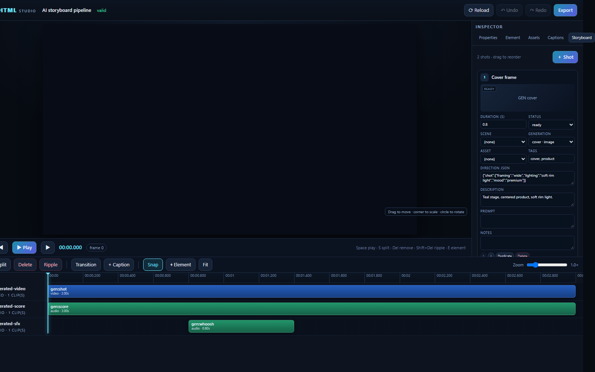
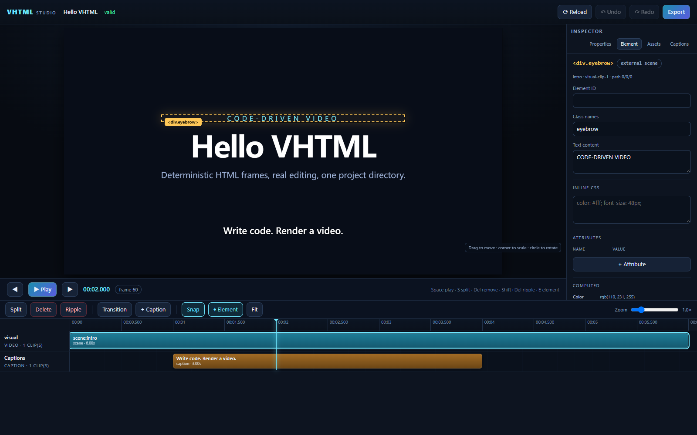
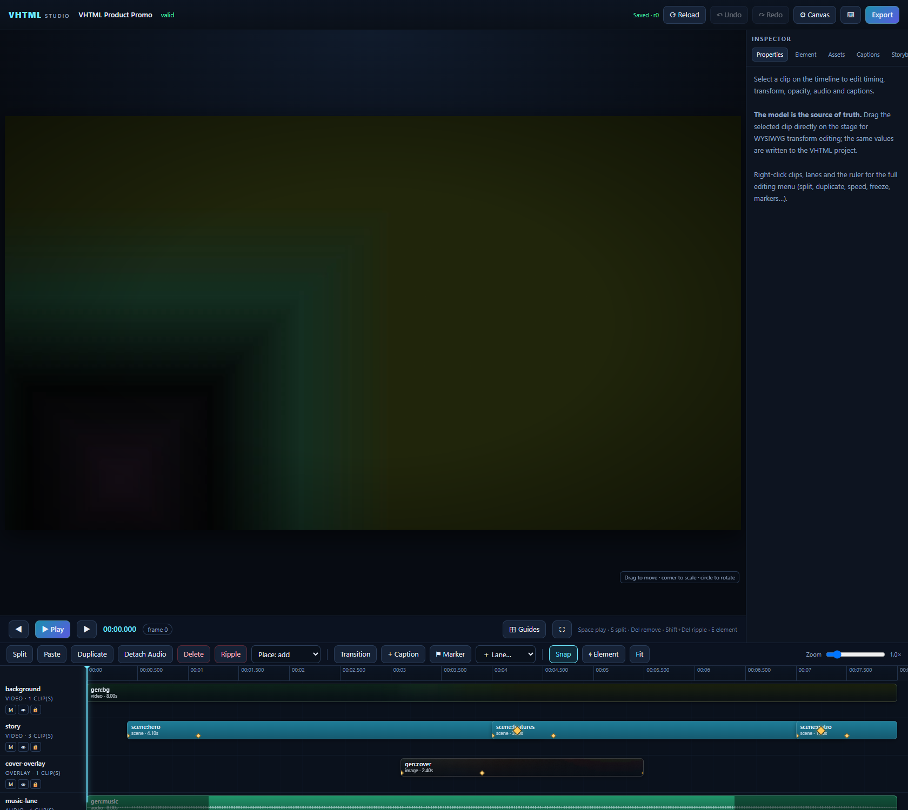
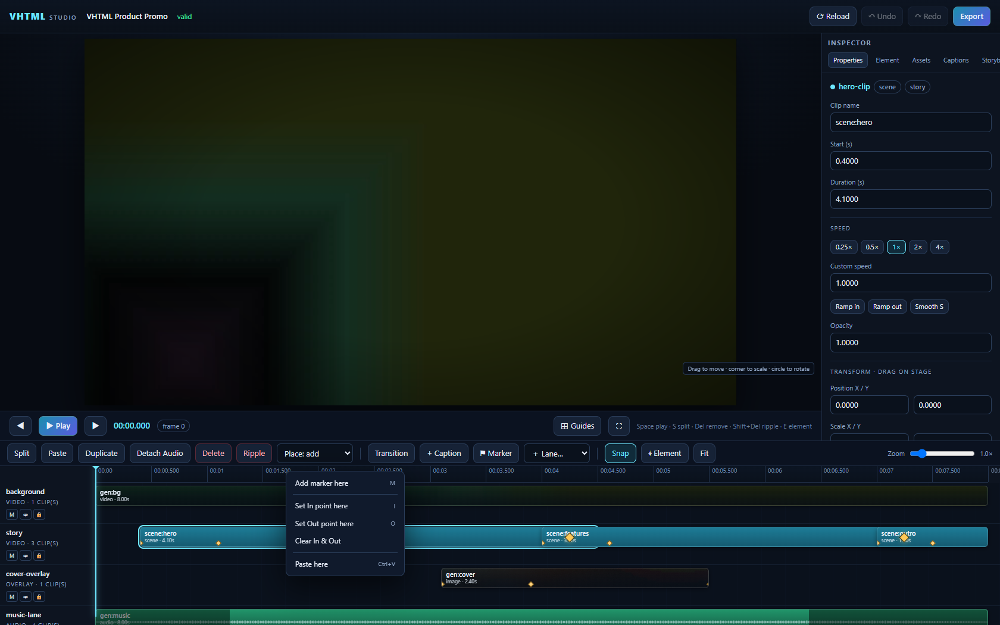

# Studio (Preview + WYSIWYG Editing)

Published as **`@sdkwork/vhtml-studio`**; also available as
`@sdkwork/vhtml/studio` and the `vhtml preview` CLI command.

```bash
# CLI (included in the meta package)
pnpm add -D @sdkwork/vhtml
pnpm exec vhtml preview ./my-film --open

# Embedded server
pnpm add @sdkwork/vhtml-studio
```

```ts
import { startStudio } from '@sdkwork/vhtml-studio';
await startStudio('./my-film', { port: 4173, open: true });
```

A project directory with `vhtml.json`, a `.vhtml` entry, or a `vhtml.json` file
is accepted.

The Studio binds to `127.0.0.1` only and serves the project root. Every edit is
applied to the Core Model, validated, saved atomically to the entry `.vhtml`,
and the stage is rebuilt. Invalid edits return `422` and do not persist.

## Storyboard

The **Storyboard** tab is a free-editing planning surface:

- **＋ Shot** adds a shot; **Duplicate** creates a copy after the current card;
- inline fields edit title, planned duration, status, tags, description, prompt,
  notes and `direction` JSON (camera, framing, lighting, sound, music);
- Scene / generation / asset selects link planning to real project objects;
- drag cards, or use ↑/↓, to reorder;
- **Delete** removes the shot and renumbers the rest;
- **⤓ Apply to timeline** materialises every shot in order onto the timeline
  (`storyboard.apply`, append + 0.25s gap, collision-checked);
- every change is a `storyboard.*` Core edit, validated and undoable; a failed
  edit is rolled back and never written to disk.

The timeline remains authoritative for playback. Storyboard edits never move
clips or change composition duration implicitly.



## WYSIWYG direct manipulation

Select a visual clip on the timeline or on the stage. A selection box appears
around the live layer:

- drag the box to move the clip;
- drag the bottom-right corner to scale X/Y;
- drag the circular handle (inside the top-right corner) to rotate;
- values are written as `clip.set { transform }` in composition pixels and
  immediately reflected in the Inspector.

The stage is scaled to the window; pointer deltas are converted with the current
`iframeRect.width / composition.width` scale. Playback hides the selection box.
The model is the only source of truth — DOM transforms are feedback until the
pointer is released.

## Element editing

Every authored HTML node inside a Scene is editable, not just the clip layer:

1. Click **⌖ Element** in the timeline toolbar (or press `E`).
2. Hover the player to see the element outline, then click a node.
3. The Inspector switches to **Element**. Edit:
   - ID and class names;
   - text for leaf nodes, or **Inner HTML** for containers;
   - any attribute (add/remove/rename), e.g. `src`, `href`, `alt`, `title`,
     `aria-label`, `data-*`;
   - inline CSS declarations;
   - read-only computed color/background/font/display/opacity for context.
4. **Apply changes** writes one validated, atomic update and refreshes the stage.



The element path is the index chain among content elements, ignoring the
`<style>`/`<script>` nodes extracted by the VHTML parser. The same path is used
for inline Scene HTML and external Scene files.

- Inline Scenes apply a `scene.set { html }` edit, so **Undo/Redo** works.
- External Scenes (`<scene src="scenes/intro.html">`) patch the external file
  directly with `parse5` source serialization, then reload the project. The file
  is the source of truth; external element edits are not added to the undo stack.
- Images, links and other scene media use the same attribute editor;
  `` dimensions can be changed with inline CSS (`width`, `height`,
  `border-radius`, `filter`, …).
- The generated `.vhtml-scene-root` wrapper and synthetic clip/caption/media
  layers are not authored HTML and are intentionally not selectable.

Element edits use the same parser/validator/serializer pipeline as the CLI. A
patch that would produce an invalid project is rejected and the Scene HTML is
left unchanged.

## Timeline



The timeline is a full non-linear editing surface; every gesture is one
validated Core Model edit (undoable, saved atomically).

- Move, trim, split, ripple delete; drag vertically to another compatible lane.
  Magnetic snapping targets clip edges, the playhead, the timeline ends **and
  every marker** (beat markers included), so trims land on the beat.
- **Roll edit**: dragging the shared edge between two adjacent clips rolls the
  cut point — both clips trim together and the gap never opens
  (`clip.roll`, magnetic-snapped, Shift bypasses).
- **Multi-select**: `Shift`/`Ctrl`+click adds clips; dragging on empty lane area
  draws a marquee rectangle; `Ctrl+A` selects all clips. Group drags move the
  whole selection; Delete removes every selected clip.
- **Clipboard**: `Ctrl+C`/`Ctrl+X`/`Ctrl+V` and the Paste/Duplicate buttons use
  the normative `timeline.copy`/`timeline.cut`/`timeline.paste` operations. The
  **Place** selector chooses `add` (overlay), `insert` (push following clips
  right) or `overwrite` (replace the covered range) for drops and pastes.
  Linked clips ride together: a detached-audio pair keeps video+audio united.
- **Context menu** (right-click a clip, lane header, ruler or transition):
  split, **split at markers (卡点)** — one click cuts every selected clip at
  the markers inside its range (自动踩点 markers included, the music-video
  workflow), **trim start / end to the playhead** (`Q` / `W`, CapCut 删除左侧
  / 右侧), duplicate, copy/cut/paste, **link/unlink** (linked clips move
  together, CapCut-style AV pairs), **replace source from Assets…** (arms the
  Assets tab with per-asset ↔ buttons running `clip.replace`, timing kept),
  speed presets (0.25×–4×), speed ramps (slow–fast–slow / fast–slow–fast /
  clear), freeze frame, detach audio, enable/disable, mute, ripple delete,
  delete; lane menus rename, mute, hide, lock, add or delete lanes; ruler
      menus drop/rename/delete markers, set In/Out points and **ripple cut the
      In→Out range across every unlocked lane** (the text-based-editing op) or
      **lift it keeping the gaps**; single clips take **color tags** (red /
      orange / green / blue / purple, stored in clip metadata and rendered as a
      strip on the clip).


- **Markers** (`M`) appear as flags on the ruler; In (`I`) / Out (`O`) points
  highlight the working range and feed the export dialog. **Auto beat
  (自动踩点)**: right-click an audio/video clip → Beat markers I (strong
  beats) / II (every beat). The server decodes the asset's audio (FFmpeg →
  mono PCM, cached), estimates tempo by autocorrelation of the onset
  envelope and snaps a beat grid to the phase with the most onset energy;
  markers land inside the clip's source window (speed/sourceIn aware) as
  coloured flags (♪ I pink, ♪ II orange) and one entry clears them all.
  Any marker can be toggled **Mark as chapter (章节)** from its menu (green
  flag); the export dialog's *Chapters from markers* muxes those into the MP4
  chapter track.
- Video clips show a **filmstrip** of poster tiles spread across the clip's
  source window (`/api/media/poster`, disk-cached); audio-capable clips
  draw a real waveform from `/api/media/peaks` (FFmpeg-decoded, cached under
  `.vhtml/cache/studio-media/`).
- **Fade handles**: drag the clip edges (or edit the fields) to set
  `fadeIn`/`fadeOut`; shaded triangles preview the ramp.
- **Volume line & envelope** (audio clips): the draggable white line maps to
  `clip.set volume` (0-200%) with a live percentage readout — the CapCut-style
  gain gesture. **Double-click the line to drop volume keyframe points**, drag
  the green dots to automate level and timing (piecewise-linear envelope
  rendered over the waveform, evaluated per-sample by the export mixer), and
  double-click a point to remove it. During playback the timeline
  **auto-scrolls** (page-flip) to keep the playhead in view. The transport is
  driven by requestAnimationFrame **plus a 100 ms timer heartbeat**, so
  playback keeps advancing when the window is occluded or not being painted
  (rAF-suspended windows used to freeze the playhead); while occluded the
  preview steps at the timer rate and catches up as soon as the window paints
  again — audio and video elements play natively throughout.
- **Keyframe diamonds drag**: drag a diamond horizontally to retime that
  keyframe (`clip.set animations`, clamped to the clip and sorted on commit).
- **Audio effects**: the Properties panel lists a clip's `audio-effect`s and
  adds effects from the mixer palette — **gain, high-pass, low-pass,
  compressor, echo/reverb, pitch shift** (each seeded with runtime-matched
  default parameters) plus sidechain **ducking** (sidechain lane, threshold,
  reduction, attack, release, hold) via `effect.add { audio: true }`; the
  export mixer evaluates the same envelope. With a multi-selection active, a
  newly added effect lands on every selected clip.
- **Speed curve editor**: clips with a time remap get an interactive SVG
  curve (X = clip time, Y = source position) with draggable points, per-segment
  average speed labels, click-to-add (monotonicity-clamped, linearly
  interpolated) and double-click-to-remove — all committed as `clip.timeremap`.
- **📷 Frame** (transport) renders the current frame to `renders/*.png` via the
  `/api/snapshot` job endpoint. With In/Out set, playback **loops the range**.
  `Alt`+drag duplicates the selection at the drop position; `Z` zooms the
  timeline to the selection. **Ctrl+drag slips the source window** of a video/
  audio clip (`clip.slip`) with a live source-in readout — project timing
  never moves; Ctrl+click without dragging still toggles selection.
- **Compound clips**: right-click creates a nested-timeline clip from the
  selection (`timeline.nest`) and flattens one again (`timeline.unnest`).
- **Crop**: the Properties panel crops a clip by frame percentage
  (`clip.set crop`); the stage and exports honour it as an inset region
  reveal.
- **Split all lanes at playhead** from the ruler context menu; `↑`/`↓` select
  the previous/next clip chronologically.
- **Keyframe diamonds** mark animation keyframes on the clip; edit them in the
  Properties panel.
- Magnetic snapping to frames, playhead, markers, 0/end and every other clip
  edge; hold `Shift` to bypass. `Ctrl`+wheel zooms around the cursor. Dragging
  a clip near the timeline's left/right edge **auto-scrolls** the view.
- Transitions open a dialog with type (crossfade, fade, dip, wipe, slide, zoom,
  blur), duration, direction and dip color.
- **Lane drag reorder**: drag a lane header vertically past a neighbour's
  midpoint to restack lanes; orders are written as `track.set` batch.
- **Lane height**: drag a lane's bottom edge to resize it (30–200px, persisted
  per lane); clip blocks and waveforms grow with the lane.
- Lane headers carry mute / solo / hide / lock switches; the lane context menu
  also sets **lane volume/pan** (consumed by the export mixer) — all through
  `track.set` semantics:
  hidden lanes are excluded from preview **and** export; solo silences other
  audio lanes in preview and export; muted lanes silence audio),
  double-click renames, `＋ Lane…` adds video/overlay/audio/caption lanes.

## Properties panel

Select a clip to edit everything the model supports:

- name, start, duration, speed (presets + custom + speed-ramp state), z, fit,
  blend, opacity, transform (also draggable on stage, with **rotation snapping**
  to level/diagonal angles and live x/y/scale/rotate readouts while dragging);
- **Layer ordering**: bring forward / send backward / front / back from the
  clip context menu; multi-selection can be aligned to the playhead;
- audio: volume, pan, fades, mute, detach-audio, and **Pitch follows speed
  (变调)** — the normative `pitch-follows-speed` clip attribute: speed
  changes shift pitch like tape (`asetrate`+`aresample` in the export mixer,
  `preservesPitch=false` in the preview) instead of the default
  pitch-preserving `atempo` stretch;
- stickers from the shape library get a **Sticker** section: pick a new
  colour and the data-URI SVG asset is regenerated in place;
- captions: text;
- **Keyframes**: add per-property keyframe tracks (opacity, position, scale,
  rotation) at the playhead, then edit each keyframe's time, value and easing
  — the easing picker offers named curves plus **cubic-bezier presets**
  (sharp in-out, soft decay, overshoot, anticipate) and steps; custom
  `cubic-bezier(...)` values are first-class end-to-end.
- **Effects**: 19 effect types (blur, brightness, contrast, saturate,
  grayscale, sepia, invert, hue-rotate, drop-shadow, glow, grain, vignette,
  tint, color-overlay, chroma-key, rounded, mask, filter, css) with friendly
  labels, per-parameter editing, enable/disable and remove. With a
  multi-selection, adding an effect applies it to the whole selection.
- **Adjust panel (调节)**: CapCut-style colour & tone sliders — brightness,
  contrast, saturation, temperature, tint, sharpen, highlights, shadows,
  fade, vignette and grain, each −100..100 (colour groups one-sided 0..100),
  double-click a label to reset one slider. One-click **looks** (Clarity /
  Warm / Cool / Vintage / Cinematic / B&W / Vivid) set the whole panel; an
  all-zero panel removes the effect so documents never carry no-op rows.
  Sliders preview **live** on the stage (the stage runtime re-renders the
  patched clip through the same evaluate path export uses) and save on
  release as one undoable edit. Colour params elsewhere (chroma-key, tint,
  drop-shadow…) gain a native swatch plus an **eyedropper** that samples any
  pixel on screen (EyeDropper API, Chromium).
- **Keyframed adjust**: every slider carries a ◇ diamond — click it to start
  an `adjust.<param>` keyframe track at the playhead (CapCut semantics: the
  first keyframe holds across the clip; ◆ at the playhead removes that
  keyframe, elsewhere adds one). Once a slider is keyframed, dragging it
  writes/updates the keyframe at the playhead (live preview included), the
  readout shows the sampled value, and the diamonds appear on the clip like
  any other keyframe track. A keyframed slider works even when the base
  effect is absent (the runtime evaluates the channel over a zero base).
- **Adjustment layer (调节层)**: the ◐ button on a video/overlay lane header
  (or *Adjustment layer…* in the lane menu) opens a lane panel with the same
  looks and sliders plus a list for other lane effects (blur, tint, vignette,
  grain…). Lane effects are normative `<lane><effect>` children: the runtime
  renders them as a backdrop filter at the top of the lane's z band, so they
  grade this lane **and every lane below it** while captions stay above and
  untouched — the CapCut adjustment-layer semantics. The lane header shows an
  **FX** badge while a layer is active; *Remove adjustment layer* clears it.
- **Curves (曲线)**: a grading-curve editor on the normative `curves` effect
  — RGB master plus R / G / B channel tabs, draggable points (end points move
  vertically), click the grid to add, double-click to remove, presets
  (S-curve, Soft S, Lift shadows, Crush blacks, Matte fade) and per-channel
  reset. The drawn curve is the Fritsch–Carlson monotone cubic the runtime
  samples into 33-entry `feComponentTransfer` tables (master first, then the
  channel), previewed live and rendered identically on export; identity
  curves remove the effect.
- **Border (边框)**: a `border` effect (width + colour swatch/eyedropper)
  draws a frame inside the clip box for picture-in-picture and stickers; it
  follows rounded corners.
- **Crop ratio presets**: Free / 1:1 / 4:5 / 9:16 / 16:9 / 2.35:1 apply a
  centred crop of the frame to that ratio (scale to refill when needed).
- **Text style (文本样式)**: caption clips expose structured typography —
  font family (suggestions include the project's font assets), size, bold,
  italic, colour, stroke (width + colour with `paint-order: stroke fill`),
  shadow (soft/hard/glow/3D-block templates), background + corner radius,
  letter spacing, line height, alignment, bottom offset and opacity — all
  stored as the normative per-cue `style` map. **花字 presets** (Classic
white, Bold outline, Neon, Boxed, Gradient, Variety) restyle the typography
keys while keeping position and alignment; "Clear text style" falls back to
the lane defaults. **竖排 (vertical)** toggles `writing-mode: vertical-rl`
for CJK vertical text, and **Credits roll (滚动字幕)** animates the cue from
below the frame to above it across the whole clip with one Y keyframe track
(drag the diamonds to retime). **Typewriter (打字机)** adds the normative
`typewriter` cue effect — glyphs appear per Unicode code point at *chars per
second* after an optional delay with an optional trailing cursor; the WebVTT /
SRT sidecar always carries the full text.
- **Keyframes travel with attributes**: *Copy attributes* also carries the
  animation tracks; *Paste attributes* drops them onto compatible clips
  (volume/pan only onto audible clips), and a separate *Paste keyframes*
  menu entry replaces the target's tracks of the same properties only.

## Effects & transitions library

The **Effects** tab is a CapCut-style palette of every runtime effect, audio
effect and transition as draggable chips.

- **Drag** an effect chip onto a timeline clip to apply it; drag an audio chip
  onto a video/audio clip; drag a transition chip onto the overlap window
  between two clips — the transition lands there with a 0.4s duration clamped
  to the overlap (the dialog is still available for type, direction and dip
  color).
- **Click** a chip to apply it to the current selection (effects apply to
  every selected visual clip).
- Chips come straight from the runtime catalogs, so a new built-in effect type
  appears in the library automatically (guarded by unit tests).
- **Animation presets** (entrance / exit / loop) apply to any visual clip
  **and to caption cues** — the CapCut text-animation workflow (fade, slide,
  zoom, bounce in/out, pulse, sway); caption clips also get the Keyframes
  section in Properties to edit those tracks.
- **Shapes & stickers (形状 · 贴纸)**: rectangle, circle, triangle, star,
  arrow, line, speech bubble and highlight bar in a chosen colour. Each
  insert registers a normative `data:image/svg+xml` asset and places a
  contained, 32 %-scaled clip at the playhead on the top overlay lane
  (created when missing), already selected for stage drag/scale/rotate;
  stickers take effects, masks, keyframes and animation presets like any
  clip.

## Assets

The **Assets** tab inventories declared and generated assets, missing references
and unused files.

- **Import** copies images/video/audio/fonts into the project layout
  (`assets/images`, `assets/video`, `assets/audio`, `assets/fonts`), probes
  metadata, hashes and registers them as `<asset>`.
- Drag an asset onto a compatible lane, or press `+` to add at the playhead.
  Images/SVG default to 3s; video/audio use their probed duration.
- Missing assets are outlined; the `↺` button relinks them to a file inside the
  project root and validates before saving. **★ Favourites**: star an asset
  (stored as asset `metadata.favorite`) and the toolbar ★ shows only the
  favourites.
- Audio lanes accept audio assets or the audio of a video asset; caption/data
  lanes reject media.
- Thumbnails come from the project static server; no external upload service.

## Captions

**Captions** tab lists cues in time order. “Cue at playhead” creates a 2s cue;
click a cue to edit its text, optional **speaker** and timing in Properties. The **Caption style** editor
writes the caption lane's `captionStyle` CSS (font size, text color, background,
bottom offset) so every cue on that lane shares one look; per-cue `style`
overrides still win. Cues export as WebVTT/SRT and can be burned in.

**Import captions**: paste SRT, WebVTT or cue JSON into the Captions tab and
press ⤓ Import cues — the normative `cuesToClips` converter parses it and every
cue lands on the caption lane at its original timestamps (the lane is created
when missing; repeated imports never collide on ids).

**Title templates**: one click adds a styled title at the playhead — main
title, lower third, corner badge and highlight presets, each a caption clip
with per-cue CSS (font, color, background, position); edit text and timing in
Properties afterwards.

## External files

- **Reload** re-reads the entry, re-parses external `<scene src>` files, rehydrates
  generated assets and rebuilds the stage. Use it after editing `scenes/*.html`,
  CSS or asset files on disk.
- Missing files are reported at startup; Studio still opens in repair mode so
  the project can be fixed/relinked.
- The manifest `paths` are obeyed for imports, generated output, renders and
  cache.

## Version history (版本历史)

**🕘** (header) opens the local backup list — the CapCut draft-backup
counterpart. Every save (each edit saves) is snapshotted under
`.vhtml/cache/studio-history/<timestamp>-r<revision>[-label].vhtml`,
deduplicated by content, spaced at least 20 s apart and capped at the last 40
files (older ones are pruned by the editor). **📌 Save version…** pins the
current state immediately with an optional label. **Restore** first snapshots
the current state (`before restore`), then reloads the chosen document through
the same path as autosave recovery — the entry file is rewritten, the undo
stack restarts, and a wrong pick is one more restore away. Autosave
(`<entry>.autosave`) remains the crash-recovery checkpoint; history is the
explicit, browsable timeline of saved states.

## Canvas & project settings

**⚙ Canvas** (header) opens the project settings: aspect-ratio presets
(16:9, 9:16, 1:1, 4:5, 2.35:1, 4K), explicit width/height, frame rate
(24/25/30/50/60), background color and **colour space** (sRGB / Display P3 /
Rec. 709 — the normative `composition color-space`, carried into export).
Everything applies as one `composition.set` edit — clips and authored HTML
keep their layout.

## Help

The **⌨** button (or `?`) lists every keyboard shortcut in a dialog. The header
shows a persistent **Saved · r<revision>** badge after every applied edit.

## Export

The export dialog offers:

- **Delivery presets** (`web-1080p`, `tiktok`, `reels`, `shorts`,
  `youtube-4k`, `square-1080p`, `cinema-4k`, `podcast-audio`, …) that set
  format, size, frame rate and fit; or fully custom settings;
- range start/duration with a **Use In/Out** shortcut for the timeline range;
- **Burn captions** into the picture, a **WebVTT sidecar**, and an
  **audit report** (`vhtml.export-report/1`);
- optional **loudness normalization** (EBU R128 `loudnorm`, e.g. `-14` LUFS);
- **封面 (Cover)**: 📷 *Set cover at playhead* stores the project cover time
  (`project.set metadata.cover-time`), and *Export cover frame* renders one
  deterministic frame as `<stem>.cover.png` next to the video after the
  export finishes (batch exports cover only the first file);
- **Chapters from markers**: muxes `type="chapter"` markers into MP4 output
  (auto-ticked when the timeline has chapter markers). MP4 chapter tracks
  cover the file from 0, so the first chapter always starts at 0:00 (the
  FFmpeg mov muxer extends it backwards) — put a chapter marker at the start
  if you want its own title; later boundaries are exact.

Completed jobs link the video, captions sidecar, report and cover.

## API

| Route | Method | Purpose |
|---|---|---|
| `/studio` | GET | Studio page |
| `/api/project` | GET | normalized studio model + diagnostics + root/layout |
| `/api/assets` | GET | asset library, summary, missing references |
| `/api/inventory` | GET | full asset inventory with origins |
| `/api/assets/upload` | POST | raw file body + `x-filename` header |
| `/api/assets/relink` | POST | `{ assetId, src }` (inside project root) |
| `/api/clip-from-asset` | POST | `{ assetId, trackId, start, duration?, mode?, fit?, scale? }` (`add`/`insert`/`overwrite`; `fit`/`scale` place stickers contained and small) |
| `/api/caption` | POST | `{ text, start, duration? }` |
| `/api/element` | POST | `{ sceneId, path, patch: { attributes?, style?, text?, innerHTML? } }` |
| `/api/edit` | POST | `{ operations: EditOperation[] }` (includes `timeline.copy/cut/paste`, `marker.*`, `track.*`, `animation.*`) |
| `/api/undo` | POST | undo |
| `/api/redo` | POST | redo |
| `/api/reload` | POST | re-read external files and reset the edit session |
| `/api/history` | GET | version history entries (`id`, `savedAt`, `revision`, `label`, `sizeBytes`) |
| `/api/history/snapshot` | POST | `{ label? }` pin the current state as a version now |
| `/api/history/restore` | POST | `{ id }` snapshot the current state, then reload that version |
| `/api/presets` | GET | delivery preset catalog for the export dialog |
| `/api/media/peaks` | GET | `?asset=<id>` normalized audio waveform buckets (cached) |
| `/api/media/beats` | GET | `?asset=<id>` 自动踩点 — `{ bpm, beats, strong, onsets }` onset + beat-grid detection (cached) |
| `/api/media/poster` | GET | `?asset=<id>&t=<sec>` JPEG frame thumbnail (cached) |
| `/api/clipboard` | POST | `{ action: copy\|paste\|clear, clipIds?, start? }` REST clipboard shim |
| `/api/snapshot` | POST | `{ time }` renders one frame to `renders/*.png` (job) |
| `/api/export` | POST | start export job (`delivery`, `burnCaptions`, `captions`, `loudness`, `report`, `cover`/`coverTime`, `chapters` supported) |
| `/api/job/:id` | GET | export progress/result |
| `/__vhtml/stage.html` | GET | live stage document |

## Keyboard

| Key | Action |
|---|---|
| Space | play/pause |
| ← / → | previous/next frame |
| Shift+← / Shift+→, PgUp / PgDn, J / L | ±1 second |
| K | pause |
| Home / End | jump to start/end |
| S | split selected clip(s) at playhead |
| Q / W | trim the start / end of the selection to the playhead |
| T | open the transition dialog |
| C | add caption at playhead |
| M | drop a marker at the playhead |
| I / O | set In / Out point |
| D / Ctrl+D | duplicate selected clip(s) |
| Ctrl+C / Ctrl+X / Ctrl+V | copy / cut / paste (Place mode honored) |
| Ctrl+A | select all clips |
| G | toggle composition guides (thirds, center, safe area) |
| F | fullscreen preview |
| + / − / 0 | zoom in / out / fit (Ctrl+wheel zooms at the cursor) |
| Delete / Backspace | remove selected clip(s) |
| Shift+Delete | ripple delete |
| Ctrl+Z | undo |
| Ctrl+Shift+Z / Ctrl+Y | redo |
| Shift (drag) | disable snapping |
| E | element picker |
| ↑ / ↓ | select previous / next clip (chronological) |
| Z | zoom the timeline to the selection |
| Alt (drag) | duplicate the dragged clips at the drop position |
| Alt+← / → | nudge selected clips by one frame |
| double-click (ruler) | drop a marker at that time |
| ? | keyboard shortcut help |
| Esc | close menu/dialog, drop selection |

Click the timecode to type an exact time (`83.5`, `1:23.5`,
`00:01:23:15` SMPTE with the project frame rate). Double-click any text on the
stage to jump straight into the Element editor for that node (CapCut-style
in-place text editing); the postMessage bridge (`?embed=1`) accepts
`vhtml:command` commands (`applyOps`, `setTime`, `play`, `pause`, `save`,
`export`, `getState`) from a host shell.

The full normative editor contract is [specification/wysiwyg.md](../specification/wysiwyg.md).
For LAN/cloud Studio with auth and TLS, see [deploy.md](./deploy.md).
