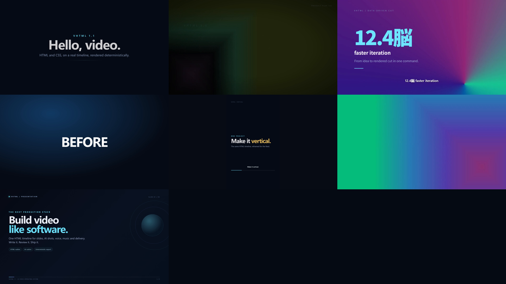
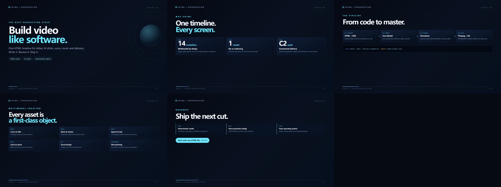
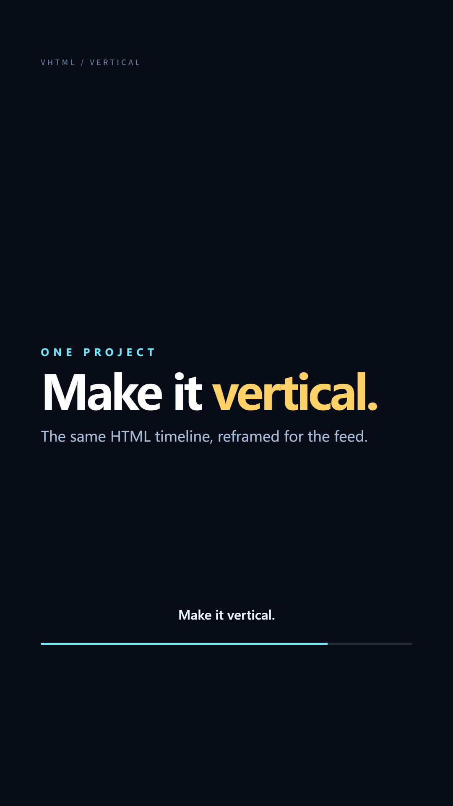

# VHTML Examples

| 示例 | 展示能力 |
|---|---|
| [`01-hello`](./01-hello) | 最小代码工程、手写 `.vhtml`、Scene、动画、字幕 |
| [`02-product-promo`](./02-product-promo) | 完整宣传片：生成背景/封面/音乐、CSS 动画、转场、效果、字幕、音频淡入淡出 |
| [`03-data-driven`](./03-data-driven) | 用循环和数据批量生成场景与时间轴 |
| [`04-programmatic-edit`](./04-programmatic-edit) | 用编辑 API 对项目执行 split/ripple/transition |
| [`05-vertical-social`](./05-vertical-social) | 原生 9:16 竖屏社交视频、安全区字幕、slide/zoom 转场、多平台交付 |
| [`06-ai-storyboard`](./06-ai-storyboard) | 分镜、图片→视频首帧依赖、音乐、音效、生成图/缓存/导出全链路 |
| [`07-ppt-video`](./07-ppt-video) | 1920×1080 PPT 风格演示视频、5 页幻灯片、fade/slide/wipe 转场 |


All examples are exported and frame-checked by:

```bash
pnpm verify:videos
```



PPT-style export (1920×1080, 13.8s, 414 frames):





## 构建

```bash
pnpm install
pnpm build
pnpm examples

# 或使用单个 workspace 包的脚本
pnpm --filter @sdkwork/vhtml-example-02-product-promo build
```

每个示例目录都有 `vhtml.json` 和私有 `package.json`（依赖
`@sdkwork/vhtml`），声明入口、源码、标准资源目录和输出目录。

## 预览与 WYSIWYG 编辑

```bash
pnpm vhtml generate examples/02-product-promo --all
pnpm vhtml preview examples/02-product-promo --open
```

在 Studio 中：选择 Clip 后可直接在画面上拖动/缩放/旋转；资源面板可导入并拖放到
时间轴；时间轴支持吸附、跨 Lane 和转场；`Reload` 会重新读取外部文件。

## 导出

```bash
pnpm vhtml export examples/02-product-promo --out examples/02-product-promo/renders/promo.mp4
```

首次导出会自动物化 `generated/` 下的生成素材。生成结果缓存于
`.vhtml/cache/generated.json`（兼容旧 `.vhtml-cache/generated.json`），可用
`--force` 重新生成。

## 外部文件与打包

```bash
pnpm vhtml assets list examples/02-product-promo
pnpm vhtml assets verify examples/02-product-promo
pnpm vhtml pack examples/02-product-promo --out examples/02-product-promo.vhtmlpkg
pnpm vhtml unpack examples/02-product-promo.vhtmlpkg --out examples/restored --force
```

`vhtml init <dir>` 会生成 `scenes/intro.html` 外部 Scene 示例、标准 `assets/`、
`generated/`、`renders/`、`.vhtml/cache/` 与 `vhtml.json`。

## 说明

- `02`/`03` 使用 `procedural` Provider，完全离线、可重复。
- `05` 是原生 1080×1920 竖屏项目，可直接用 `--delivery tiktok|reels|shorts` 导出。
- `01-hello/hello.vhtml` 为手写文档；`hello-code.vhtml` 由 SDK 生成。
- `08-code-video` 是**单文件程序文档**：无 TS 源，内嵌创作程序 + JSON 数据块
  生成数据驱动场景、生成任务、变速曲线、嵌套时间线与音频闪避。导出需
  `--generate`；`vhtml build video.vhtml` 可将程序冻结为纯声明式文档。
  详见 [../specification/video-authoring.md](../specification/video-authoring.md)。
- `04` 的 `.vhtml` 是编辑后的最终项目，源文件 `edit.ts` 展示编辑过程。
